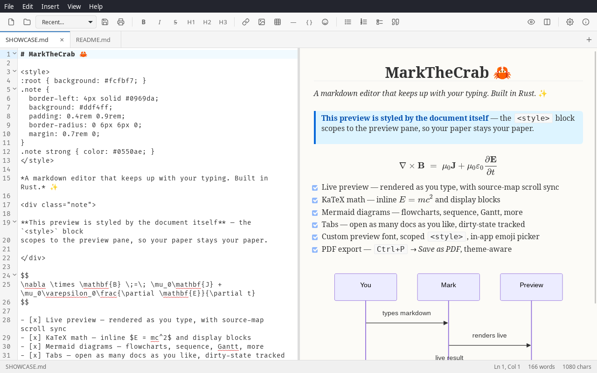

<p align="center">
  
</p>


A cross-platform markdown editor built on [Tauri](https://v2.tauri.app/) + Rust + [CodeMirror 6](https://codemirror.net/). Meet Mark — he sweats when your mermaid syntax breaks, bounces when you tap him, and celebrates when you save.

## Features

- **Live preview that renders what you wrote.** [pulldown-cmark](https://github.com/pulldown-cmark/pulldown-cmark) on the Rust side, CodeMirror on the editor side, 150 ms debounce, source-map-based scroll sync instead of a ratio.
- **Math.** Inline and display KaTeX with `$x^2$`, `$$…$$`, `\(…\)`, `\[…\]`, and ` ```katex ` / ` ```math ` fences. Lazy-rendered, so multi-thousand-equation docs don't block the main thread.
- **Diagrams.** Mermaid in ` ```mermaid ` fences, also lazy.
- **Custom markdown.** `==highlight==`, `^superscript^`, `~subscript~`, checklists, footnotes, autolinks, smart punctuation, `[TOC]`.
- **Ten themes.** GitHub, Dark, Foghorn, Handwriting, Markdown, Metro Vibes (light + dark), Modern, Solarized (dark + light). Scoped at load time so they style only the preview, never the app chrome.
- **Custom CSS.** Scoped editor for writing your own preview rules.
- **Accessibility.** OpenDyslexic bundled under OFL-1.1, RTL text direction, spellcheck toggle.
- **Safety by default.** Window-close guard, external-change detection on save, recent-files menu.
- **PDF export.** `Ctrl+P` → *Save as PDF* produces a clean styled document using the current theme.

See [`SHOWCASE.md`](SHOWCASE.md) for every feature demonstrated side-by-side with its markdown source.

## Download

Installers are on the [Releases](https://github.com/HoldMyBeer-gg/MarkTheCrab/releases) page. The builds aren't code-signed yet, so each OS warns the first time:

- **macOS** (Apple Silicon only for now; no Intel build yet). On macOS 15 and later it says *"MarkTheCrab is damaged and can't be opened"*. The app is fine; that's how macOS blocks unsigned downloads. Drag it to Applications, then run this once in Terminal:

  ```bash
  xattr -dr com.apple.quarantine /Applications/MarkTheCrab.app
  ```

  If you keep it somewhere else, type `xattr -dr com.apple.quarantine ` and drag the app onto the Terminal window to fill in its path. If macOS instead says *"cannot be opened because the developer cannot be verified"*, open **System Settings → Privacy & Security** and click **Open Anyway**.

- **Windows**: use `MarkTheCrab_<version>_x64-setup.exe` (the `.msi` is for managed installs; stick to one of the two so upgrades don't leave two entries in Add/Remove Programs). It shows *"Windows protected your PC"*: click **More info**, then **Run anyway**.
- **Linux**: install the `.deb` / `.rpm`, or run the AppImage with `chmod +x MarkTheCrab_*.AppImage`. AppImages need FUSE 2, which recent distros don't install by default: `sudo apt install libfuse2` (Ubuntu 22.04) or `sudo apt install libfuse2t64` (Ubuntu 24.04+).

## Quickstart

```bash
git clone https://github.com/HoldMyBeer-gg/MarkTheCrab
cd MarkTheCrab
pnpm install
pnpm tauri dev       # dev run
pnpm tauri build     # release build for your platform
```

Requirements: Node.js 20+, Rust 1.80+, and the [platform prerequisites for Tauri 2](https://v2.tauri.app/start/prerequisites/).

## Mobile

iOS and Android targets are planned via Tauri mobile. The icon sets are already scaffolded under `src-tauri/icons/ios/` and `src-tauri/icons/android/`; the mobile build itself isn't wired up yet.

## Credits & attribution

The preview themes in `src/themes/` are derived from the [Remarkable](https://github.com/jamiemcg/Remarkable) markdown editor by Jamie McGowan (MIT). Every other bundled dependency — CodeMirror, highlight.js, KaTeX, Mermaid, pulldown-cmark, ammonia, regex-lite, Tauri — is reproduced verbatim in the **About** dialog inside the app (`src-tauri/third-party-licenses/`).

OpenDyslexic font © Abbie Gonzalez, under the [SIL Open Font License 1.1](src-tauri/third-party-licenses/OpenDyslexic-OFL.txt). A copy of the OFL ships next to the font files per the license's redistribution requirement.

## License

[MIT](LICENSE) — original MarkTheCrab work © jabberwock, 2026. Remarkable-derived portions © Jamie McGowan, 2024.
