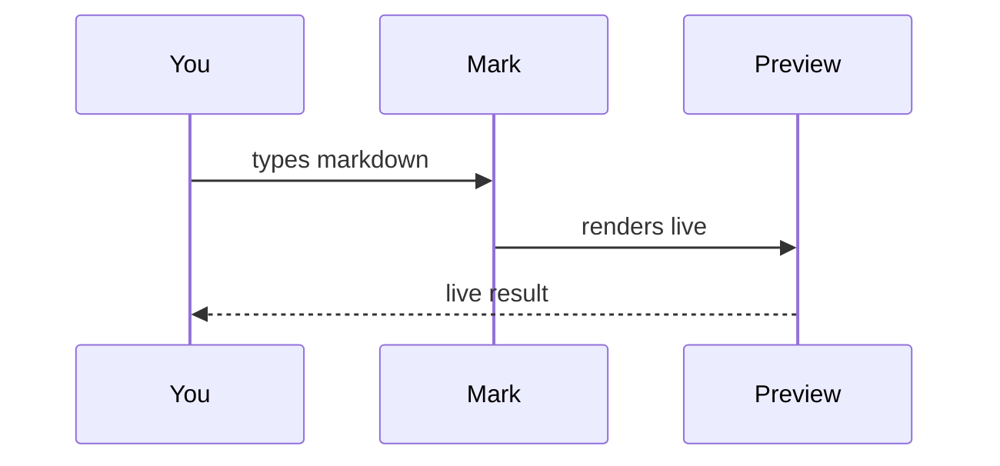

# MarkTheCrab 🦀

*A markdown editor that keeps up with your typing. Built in Rust.* ✨

**This preview is styled by the document itself** — the `<style>` block
scopes to the preview pane, so your paper stays your paper.

$$
\nabla \times \mathbf{B} \;=\; \mu_0\mathbf{J} + \mu_0\varepsilon_0\frac{\partial \mathbf{E}}{\partial t}
$$

- [x] Live preview — rendered as you type, with source-map scroll sync
- [x] KaTeX math — inline $E = mc^2$ and display blocks
- [x] Mermaid diagrams — flowcharts, sequence, Gantt, more
- [x] Tabs — open as many docs as you like, dirty-state tracked
- [x] Custom preview font, scoped `<style>`, in-app emoji picker
- [x] PDF export — `Ctrl+P` → *Save as PDF*, theme-aware

